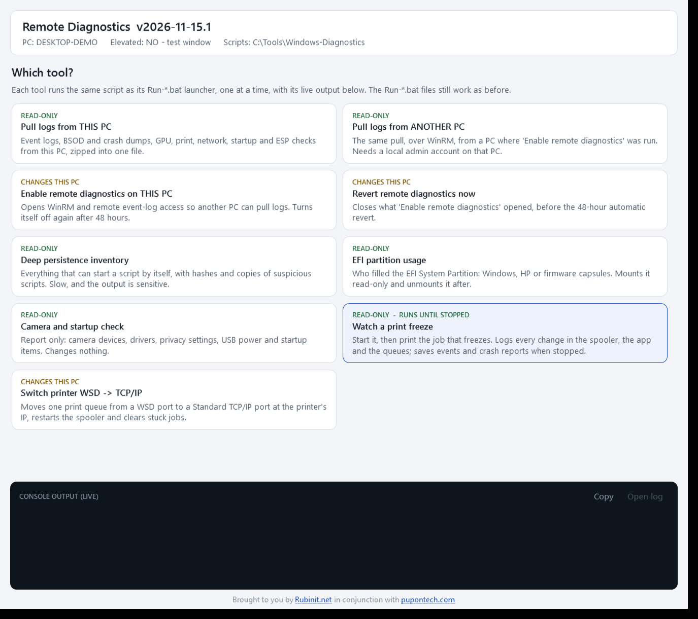
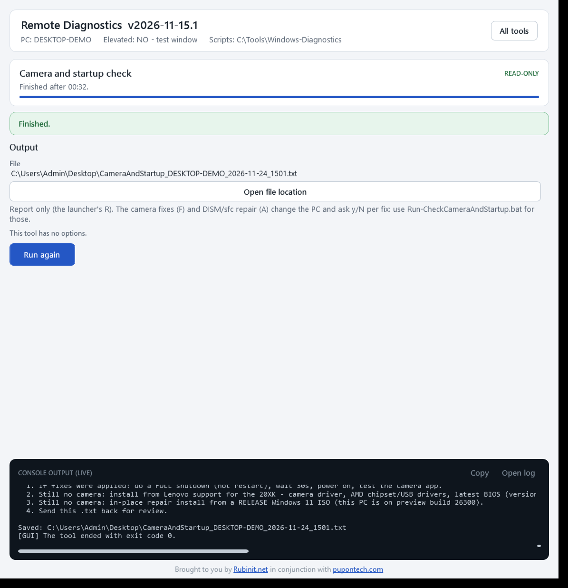

# Remote Diagnostics

**One window to find out why a Windows PC crashes, freezes, won't print or won't wake up.**

When a PC misbehaves, the clues are scattered: event logs, crash dumps, driver versions, print queues,
startup items, the network. Remote Diagnostics collects all of it in one run, decodes the useful parts
(blue screens, GPU resets, failed resumes, stuck printers) and hands you a single zip file with a short
**REVIEW LIST** of what to look at first. It can run on the PC itself or pull the same logs from another
PC on the network.

## Quick start

1. Copy this whole folder onto the PC (USB stick, shared drive, remote session). Keep the files together.
2. Double-click **`Run-RemoteDiagGui.bat`** and say **Yes** to the administrator prompt.
3. Pick a tool card, set its options, press **Run** and watch the live output.
4. When it finishes, click **Open folder** / **Open zip location**. Send the zip to whoever is helping.

Every tool also has its own `Run-*.bat` launcher if you prefer a plain console.

## The tools

Cards marked **READ-ONLY** only look. Cards marked **CHANGES THIS PC** ask before they run, and the window
can't be closed halfway through one.

| Tool | Launcher | What it does |
|---|---|---|
| **Pull logs from THIS PC** | `Run-PullLocalLogs.bat` | Event logs, blue-screen decoding and minidumps, GPU/TDR resets, print-spooler errors and every print queue, network state (with a public IP / ISP check), startup items and scheduled tasks, EFI partition usage. One zip, with a REVIEW LIST on top. Default look-back 72 hours (1 to 168). |
| **Pull logs from ANOTHER PC** | `Run-PullRemoteLogs.bat` | The same pull over the network (WinRM) from a PC where *Enable remote diagnostics* was run. Needs a local admin account on that PC. The password goes straight to the script and is never shown, saved or logged. |
| **Enable remote diagnostics** | `Run-EnableRemoteDiag.bat` | Run on the PC you want to diagnose. Opens WinRM and remote event-log access, and **turns itself off again after 48 hours**. |
| **Revert remote diagnostics now** | `revert-remote-diag.ps1` | Closes that access early. |
| **Deep persistence inventory** | `Run-PullPersistence.bat` | Everything that can start a program or script by itself (tasks, Run keys, services, WMI, every user's profile), with hashes and copies of suspicious scripts. Slow, and the output is sensitive. |
| **EFI partition usage** | `Run-CheckEspUsage.bat` | "EFI partition full"? Shows who filled it: Windows, the PC maker or firmware updates. Mounts it read-only and unmounts after. |
| **Camera and startup check** | `Run-CheckCameraAndStartup.bat` | Camera devices, drivers, privacy settings, USB power saving and startup items. The console launcher also offers fixes, asking for each one. |
| **Watch a print freeze** | `Run-WatchPrintFreeze.bat` | Start it, then print the job that freezes. It logs every change in the spooler, the app and the queues, and saves events and crash reports when you stop it. |
| **Switch printer WSD -> TCP/IP** | `Run-SwitchPrinterToTcpIp.bat` | The usual fix for a printer that stalls: moves the queue from a WSD port to a standard TCP/IP port at the printer's IP, keeps the queue name, restarts the spooler and clears stuck jobs. Has a `-DryRun` mode. |

Two more, outside the window:

- **`Run-CheckWakeDevices.bat`**: for devices that stop working after sleep or hibernate. Optional live
  sleep test (snapshot, sleep, wake, compare), plus every wake, failed resume and device error grouped by
  how often it happens right after waking. Report only; never changes anything.
- **`Pull-BootFailureLogs.bat`**: for a PC that **won't boot at all**. Run it from the recovery Command
  Prompt (WinRE) or a WinPE USB. Pure batch, no PowerShell needed. Collects Startup Repair logs, the boot
  log, CBS/DISM and setup logs, offline event logs, BCD and disk layout onto the USB stick, and turns boot
  logging on for the next attempt. Set the `PE_DRIVE` letter at the top first.

## What leaves the PC?

- The output stays on the PC: on the Desktop of the person who is signed in (`RemoteDiagLogs\`), or the
  folder you choose. Nothing is uploaded.
- One online lookup: the pull tools ask `ip-api.com` for the PC's public IP and internet provider, so the
  report can flag content-filtering ISPs that interfere with certificates and updates.
- Logs can contain computer names, user names and installed software. Treat the zip as private.

## Requirements

- Windows 10 or 11, Windows PowerShell 5.1 (built in). Run as administrator; the `.bat` files ask for you.
- For pulling from another PC: both PCs on the same network, TCP 5985 open, and *Enable remote
  diagnostics* run on the target first.

## For developers

- The window (`gui\`) is a front end only. It runs the same dated scripts the `Run-*.bat` files run, with
  the same arguments, and shows their output. Design notes: [`docs/gui-architecture.md`](docs/gui-architecture.md).
- Each script carries its version in its file name (`<Name>.v<YYYY-MM-DD>.<N>.ps1`). The launchers pick
  the newest one automatically.
- Tests: from a **non-elevated** Windows PowerShell, run each `tests\gui\Test-*.ps1`.
- `New-SelfContainedBat.ps1` wraps any script into a single self-elevating `.bat` for locked-down PCs
  where Group Policy blocks `.ps1` files.

## License

MIT. Made by [Rubin IT](https://rubinit.net), with [pupontech](https://pupontech.com). Use it at your own
risk.
